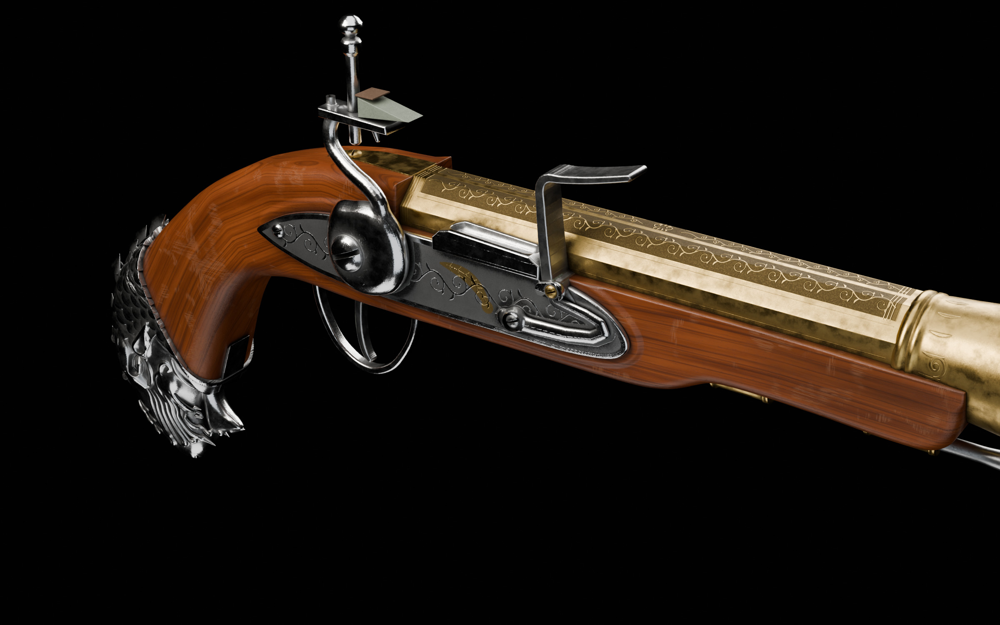
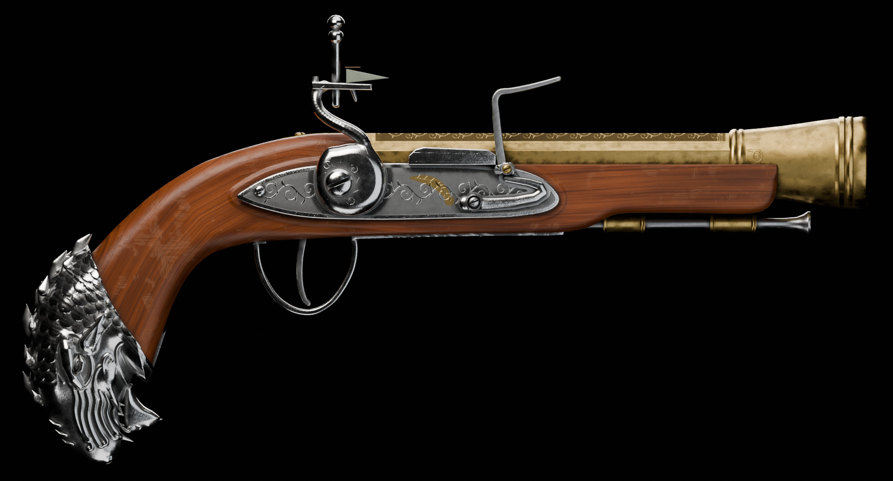
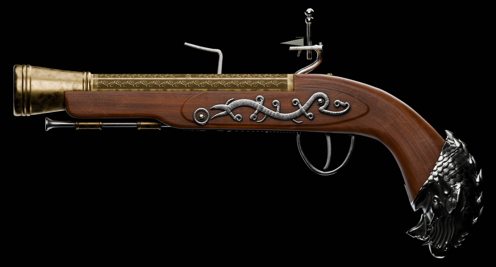
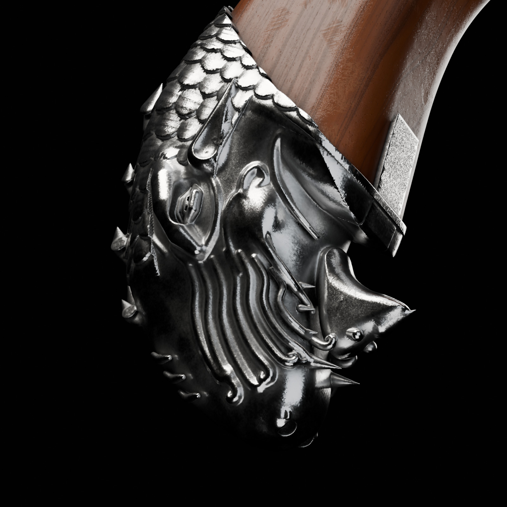
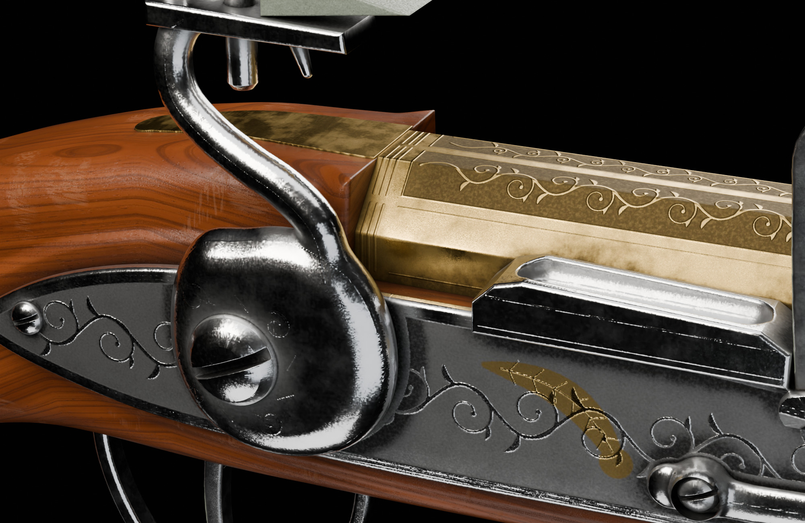

# The Gargoyle's Breath: fan-made 3D replica

A high-detail 3D model of Edward Kenway's silver gargoyle-head blunderbuss
pistol, built from the *Black Flag Resynced* Character Reference Guide
(page 12, plus the holster and close-up views on pages 2–4 and 8).

> **Unofficial fan work, for non-commercial use only.** The reference guide
> was published by the development team to invite fan creations. This model
> is a personal or community fan creation in that spirit. It is not affiliated
> with or endorsed by Ubisoft. *Assassin's Creed* and related names are
> trademarks of Ubisoft Entertainment. Selling the model, prints, or
> derivatives requires a licence from the rights holder. No reference
> imagery is included in this repository.



| | |
| --- | --- |
|  |  |
|  |  |

## Files

| File | Contents |
| --- | --- |
| `GargoylesBreath.glb` | Full-detail glTF 2.0 binary (~956k triangles, 4K textures, 70 MB), real-world scale (metres, Y-up), PBR metal/rough materials with baked textures. Standard glTF 2.0: opens in Blender, three.js/Babylon, Godot, online glTF viewers, and Unreal/Unity through their glTF importers. |
| `GargoylesBreath_lite.glb` | Lightweight variant (~356k triangles, 2K textures, 19 MB) for web viewers and quick sharing. |
| `GargoylesBreath.blend` | Blender 5.2 scene with the same baked materials, the original procedural materials (fake-user, for re-baking), and animation-ready pivots. |
| `textures/` | Baked atlases per material: `T_<Set>_BaseColor.jpg` (sRGB), `T_<Set>_ORM.jpg` (R occlusion, G roughness, B metallic), `T_<Set>_Normal.jpg` (tangent space, OpenGL +Y). Sets: Walnut, Brass, Silver (4096²) and Steel (2048²). |
| `textures/source/` | Procedural engraving height and grime maps used by the materials. |
| `renders/` | Cycles studio renders of the baked model: right, left, top and front orthographic views, plus hero, lock, muzzle and gargoyle close-ups. |
| `source/` | Python build pipeline. Every part is generated from measurements of the reference, so the model can be rebuilt or modified. |

## Specifications

| | |
| --- | --- |
| Overall length | 450 mm |
| Barrel | 268 mm, octagonal breech 31.4 mm across flats, raised ring, trumpet muzzle Ø 49 mm |
| Lock | Swan-neck cock at full cock, frizzen open (as shown in the reference), engraved lock plate with gold-inlay feather |
| Furniture | Silver gargoyle butt cap, grip strap flowing into the jaw, trigger guard, dragon side plate, brass ramrod pipes and barrel tang |
| Scale | 0.73 mm per reference-image pixel. The guide gives no dimensions, so the 450 mm length is inferred from grip and hand proportions typical of large period pistols. |
| Geometry | ~956k triangles in 29 objects (full GLB), modelled in millimetres at real-world scale. Feature positions are within about ±2 mm of the reference measurements. |

### Parts and pivots

Each part is a separate object parented under `GargoylesBreath`. Moving parts
have their origin on their real pivot axis (rotate about local Y):

* `Cock` sits on the tumbler axis. `Cock_JawScrew`, `Flint`, `Flint_Leather` and `Screw_Cock` are its children.
* `Frizzen` sits on the frizzen screw axis.
* `Trigger` sits on the trigger pin.

Other parts: `Stock`, `ButtCap_Gargoyle`, `Barrel`, `Barrel_Muzzle`,
`BarrelTang`, `Ramrod`, `RamrodPipe_Front/Rear`, `LockPlate`, `Pan`,
`FrizzenSpring`, `SidePlate`, `TriggerGuard`, `GripStrap`, and the screws and
pins.

## How it was built

1. **Measurement.** The right- and left-side orthographic views on page 12
   were traced in image space (`source/gb_profiles.py`). They agree to within
   a few pixels after mirroring, which gives the side silhouette of every part.
   Widths come from the top-view inset and the holster close-ups.
2. **Organic parts** (walnut stock and gargoyle head) are signed-distance-field
   sculpts meshed with marching cubes. The stock inflates the traced
   silhouette, with variable width and edge rounding, raised lock panels, and
   barrel and ramrod channels. The head carries overlapping scale rows,
   blade-like crest spikes, swept ears, an almond eye under a heavy brow,
   carved flame reliefs, nostrils, fangs, and an open jaw that merges into the
   grip strap.
3. **Hard-surface parts.** The barrel and muzzle are clean lathe and prism
   meshes. The lock work, guard, trigger, side plate and screws are SDF
   profile extrusions and sweeps.
4. **Engraving.** Baroque vine scrolls, a mirrored arabesque with a grotesque
   mask on the top flat, and bell volutes are generated procedurally
   (`gb_engrave.py`) as height and grime maps, not copied from the reference.
5. **Materials.** Procedural Cycles materials (walnut grain that follows the
   stock's curve, tarnished silver and brass with cavity grime and polished
   edges) are baked to the PBR atlases above (`gb_bake.py`).

### Rebuilding

```bash
pip install bpy==5.2.2 numpy scipy scikit-image pillow
cd source
python3 gb_engrave.py                                  # engraving maps
python3 gb_build.py final ./cache ./GargoylesBreath_src.blend
python3 gb_bake.py ./GargoylesBreath_src.blend ..       # bake + .blend + .glb
python3 gb_render.py ../GargoylesBreath.blend ../renders   # PNG, Cycles
```

The committed renders are JPEG conversions of those PNGs. `bpy` 5.2.2 needs
Python 3.13.

`gb_build.py draft …` gives a fast preview build, and
`python3 gb_lite.py ../GargoylesBreath.blend ../GargoylesBreath_lite.glb`
rebuilds the lightweight GLB.
